# Resume builder

A resume builder: write your CV once as YAML, add a photo, and get a web page, PDFs and Word documents in any of thirteen themes. Every output is A4, in as many languages as the YAML holds.

`example/resume.yaml` and `example/headshot.jpg` are a fictional example; the photo is AI-generated.

To keep your own CV in its own repo, add this one as a submodule and build from there; [ali-mosavian/resume](https://github.com/ali-mosavian/resume) does that and publishes to GitHub Pages.

## Use

1. Write your CV as YAML; `example/resume.yaml` is a complete example. List the languages under `langs:`. Translated text sits under language keys (`en:`, `sv:`), and a missing language is an error.
2. Point `photo:` at your photo, relative to the YAML. The build finds the face with OpenCV and crops a square around it, so a snapshot of any shape is framed the same way on the page, in the PDF and in Word.
3. Build:

```bash
uv run resume build --cv path/to/resume.yaml --theme bracket --template templates/bracket.docx
```

`build/` then holds `index.html` (every language, with a switch), and per language a PDF and a `.docx`, named by the YAML's `download:`.

## Themes

Page 1 of the example in each theme: the web page, its PDF and the `.docx` as Word lays it out (`tools/showcase.sh`).

### aurora


### aurora-v2

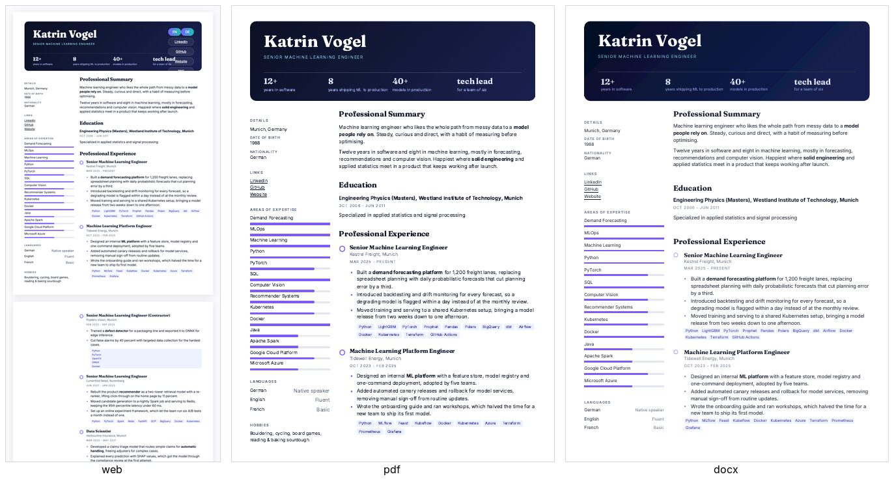

### aurora-v3

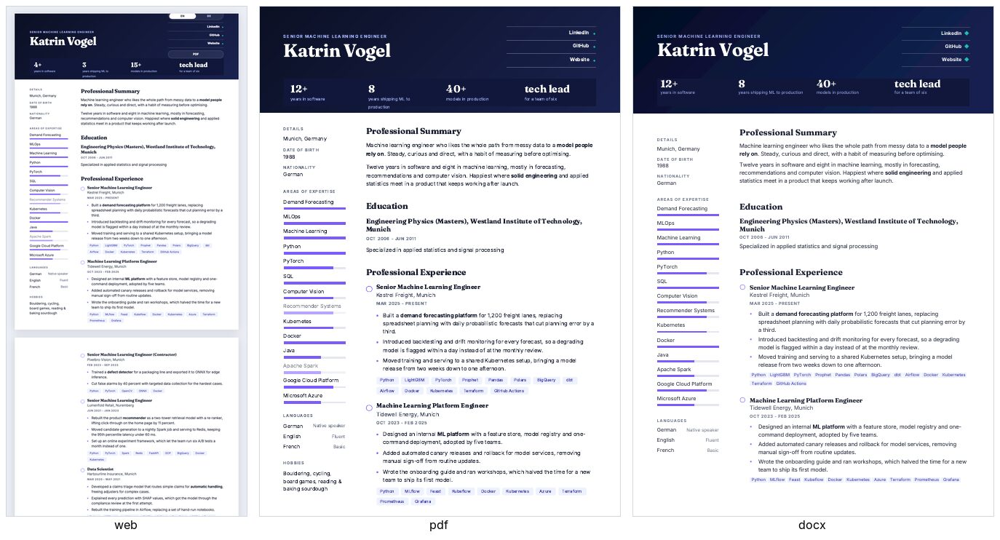

### bracket

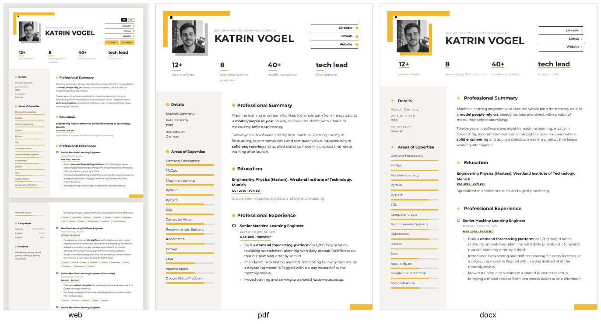

### cinematic

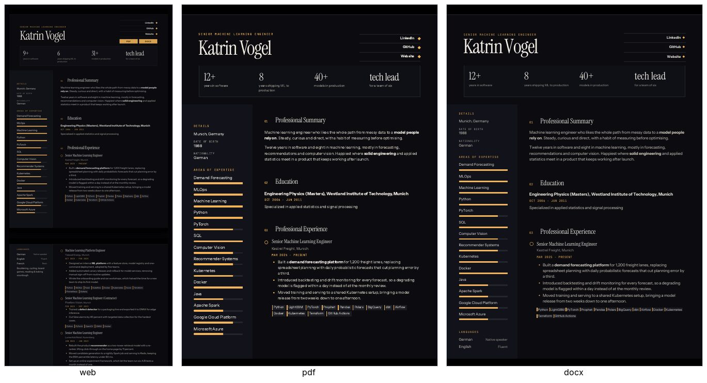

### constellation

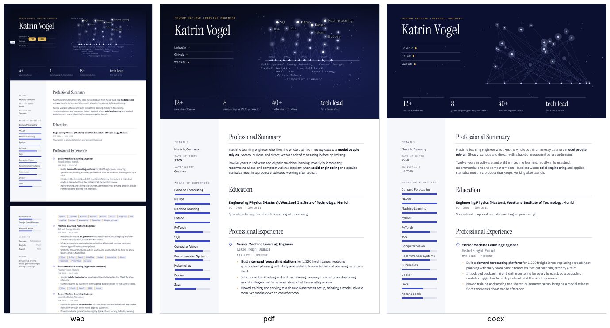

### editorial

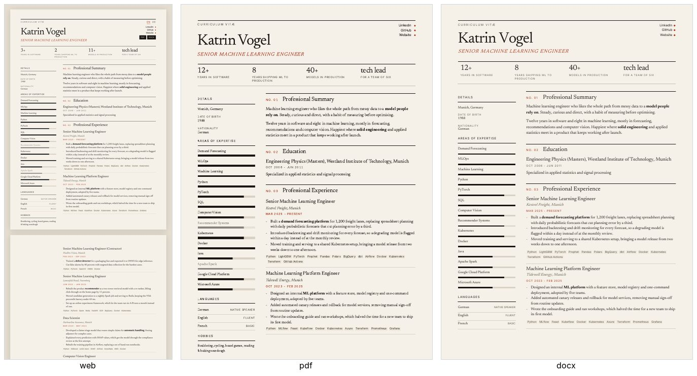

### kinetic

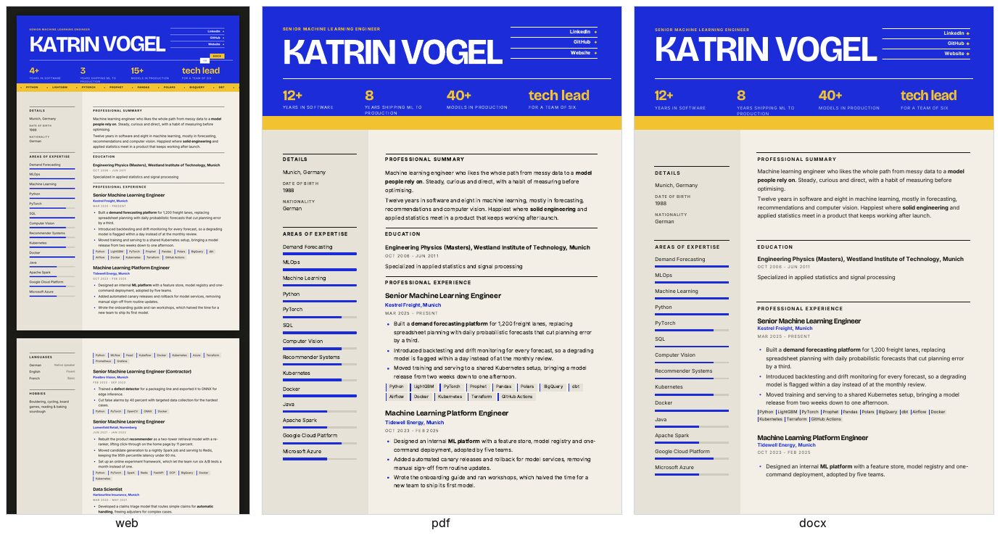

### midnight

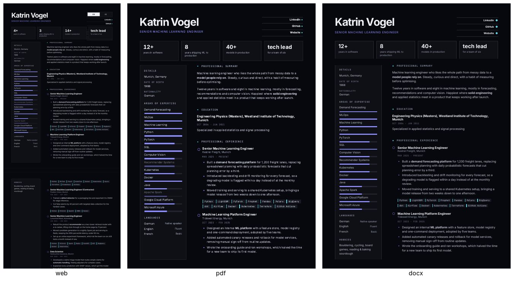

### pro

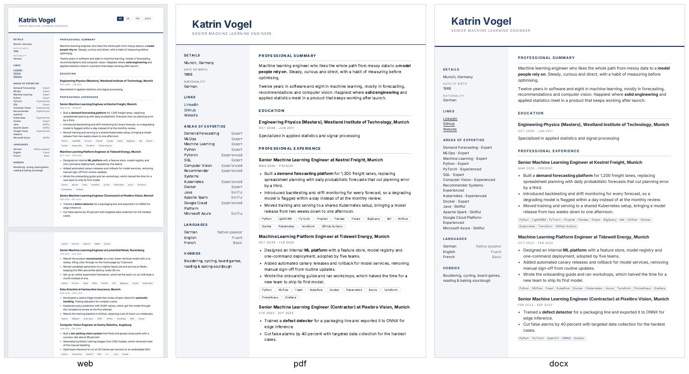

### slate

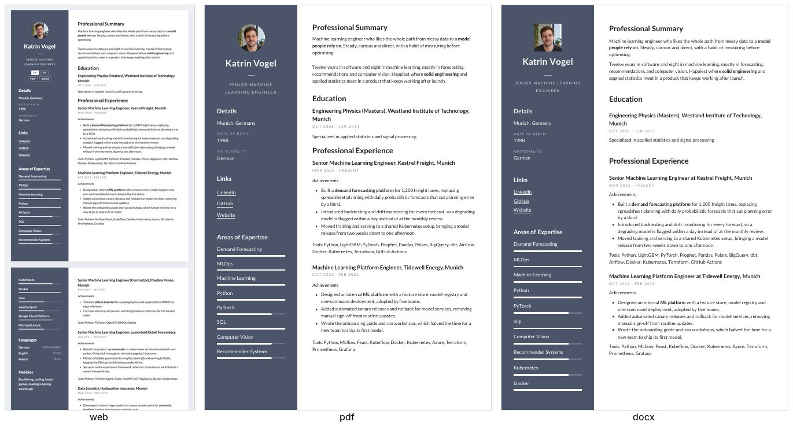

### split

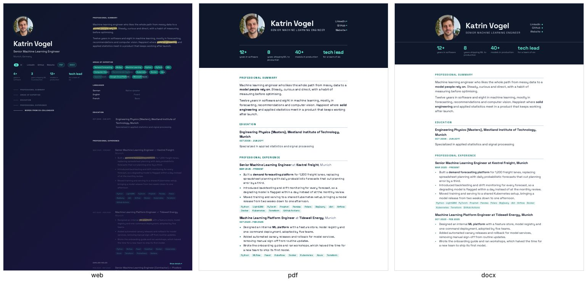

### swiss

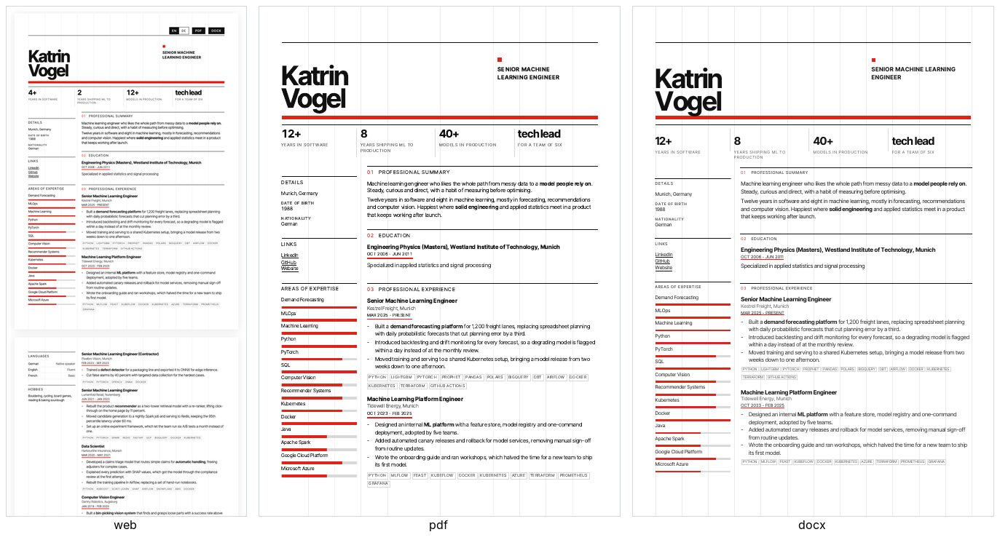


Each theme is `themes/<name>.css` (plus optional `<name>.js` / `<name>.*.js`) for the web and PDF, and `templates/<name>.docx` for Word, generated by `src/resume/docx_templates/<name>.py` (`uv run resume template <name>`).

## Develop

```bash
uv run pytest
```

```bash
uv run isort . && uv run ruff format && uv run ruff check && uv run ty check
```

`tools/compare.sh <theme> [lang]` renders a theme's PDF and Word pages side by side, Word as Microsoft Word lays it out. `tools/fonts.py` fetches the themes' fonts into `assets/fonts`.
